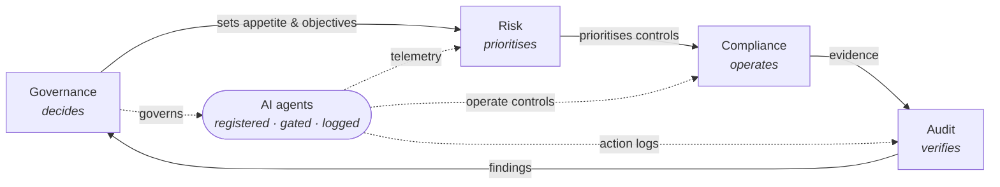

# Agentic GRC Handbook: Governance, Risk, Compliance & Audit

> How a SaaS provider steers itself, decides which threats matter, meets its obligations every day, and proves it, with evidence and independence, in a company where AI agents are both workers inside the GRC program and subjects of it.

| | |
|---|---|
| **Applies to** | Whole company |
| **Owner** | CISO (maintainer), Board (approver) |
| **Review cadence** | Annually or on material change |
| **Version** | 2.1 |

## Table of contents

- [Overview & philosophy](#overview--philosophy)
- [How the four functions interlock](#how-the-four-functions-interlock)
- [1 · Governance](#1--governance)
- [2 · Risk Management](#2--risk-management)
- [3 · Compliance](#3--compliance)
- [4 · Audit](#4--audit)
- [Three lines of defence](#three-lines-of-defence)
- [Worked example: landing an enterprise deal with SOC 2](#worked-example-landing-an-enterprise-deal-with-soc-2)
- [The autonomy ladder](#the-autonomy-ladder)
- [Separation of duties](#separation-of-duties)
- [Glossary](#glossary)

---

## Overview & philosophy

This handbook follows the same philosophy as [GitLab's public handbook](https://handbook.gitlab.com/): it is the **single source of truth** for how our GRC program works. If a process isn't written here, it doesn't exist; if the handbook is wrong, fix the handbook rather than working around it. Anyone in the company should be able to read this page and understand who decides what, which risks we're carrying, what we've promised customers and regulators, and how we prove we keep those promises.

> **Handbook-first.** Changes to policy, risk appetite, control ownership, or audit scope are made *by changing this handbook* through a reviewed merge request, not in slide decks, DMs, or meeting notes. The diff is the decision record.

GRC is four functions with distinct jobs. The shortest version:

> **Governance decides. Risk prioritises. Compliance operates. Audit verifies.**

| Function | Core question |
|---|---|
| **1 · Governance** | Who is accountable, and what does good look like? |
| **2 · Risk Management** | What could hurt us, how badly, and what are we doing about it? |
| **3 · Compliance** | What must we do, and are we actually doing it, today? |
| **4 · Audit** | Can we prove it, with evidence and independence? |

### What "agentic" changes

Agentic GRC cuts in two directions at once, and this handbook keeps them distinct throughout; conflating them is the most common confusion in this space:

**Agents doing GRC**: AI agents as **workers inside the GRC program**: collecting evidence continuously, monitoring controls for drift, drafting policies and vendor assessments, preparing access reviews, pre-screening audit samples. This changes how the program is *operated*.

**GRC of agents**: AI agents as **subjects of governance**: every agent registered with a named human owner and an autonomy level, non-human identities held to least privilege, consequential actions gated by humans, and a new obligation landscape (EU AI Act, ISO/IEC 42001, NIST AI RMF). This changes what the program must *cover*.

> ✅ **First principle.** Accountability never transfers to an agent. Every agent action is attributable to a named human owner, and "the agent did it" is never an accepted root cause. Agents change how work gets done; they change nothing about who answers for it.

---

## How the four functions interlock

**A loop, not a stack.** Governance sets objectives and appetite at the top. Risk translates that appetite into priorities. Compliance builds and runs the day-to-day control environment those priorities call for. Audit independently tests the result and feeds findings back to Governance, which adjusts direction, and the cycle begins again.

AI agents sit **inside** this loop, not beside it: they operate mostly within Compliance (running controls and collecting evidence), feed telemetry to Risk and action logs to Audit, and are themselves governed from the Governance box: registered, gated, and logged.

| Function | Posture | Cadence | Core question | Reports to |
|---|---|---|---|---|
| **Governance** | Directive | Standing (board/exec forums) | Who is accountable, and what is good? | Shareholders / owners |
| **Risk** | Forward-looking | Continuous, formally quarterly | What could hurt us, and how much do we care? | Exec / risk committee |
| **Compliance** | Preventative, operational | Continuous, daily | Are we meeting our obligations right now? | Management (CISO / Legal) |
| **Audit** | Backward-looking, assurance | Periodic (point-in-time / period) | Can we prove it worked? | Board / audit committee |

> **Rule of thumb.** Compliance says *"here is the policy and here is how we follow it."* Audit says *"show me the evidence that you followed it in March."* A company can be compliant on paper and still fail an audit if it cannot produce the evidence.

---

## 1 · Governance

*The steering function: who decides what, and what "good" looks like.*

Governance defines the structures, policies, and decision rights that every other function hangs off. It is where the board and executive team set direction, appetite, and accountability. Governance does not run controls or chase evidence; it creates the conditions under which those things happen, and it is where the buck stops.

### What Governance owns

**Risk appetite statements**: board-approved boundaries the rest of the program is calibrated to. Examples: *"customer data does not leave approved regions"*, *"we do not tolerate unencrypted customer data at rest"*, *"platform availability below 99.9% monthly is unacceptable."*

**The policy hierarchy**: an Information Security Policy at the top, with subordinate policies beneath it: Acceptable Use, Secure SDLC, Access Control, Vendor Management, Data Classification & Retention, Incident Response. Each policy names one accountable owner and a review date.

**Ownership and decision rights**: clear, named accountability: the CTO owns platform availability, the CISO owns security, Legal owns privacy, the CFO owns financial controls. Every production system and data store has a named owner. "Shared" ownership is treated as no ownership.

**Escalation paths**: pre-agreed routes for when something big happens: which incidents reach the exec team within the hour, which reach the board, and who is authorised to notify customers or regulators.

**Structure and forums**: the committees where direction is set and exceptions are decided (see below).

### Governing agents

Agents are governed the same way systems and data are: named ownership, explicit boundaries, and decisions made at the right level. Three mechanisms carry that:

**The agent registry**: every deployed agent has a registry entry before it acts: a named human owner, its purpose, its autonomy level (see [the autonomy ladder](#the-autonomy-ladder)), the model and version it runs on, and the systems and data it may touch. An agent not in the registry is a shadow agent, treated exactly like shadow IT.

**Autonomy appetite statements**: board-approved boundaries for what agents may do without a human in the loop. Examples: *"agents may draft but never send regulator or customer communications"*, *"agents may collect and file evidence autonomously, but may not close audit findings"*, *"no agent modifies production access rights without human approval."*

**Agent decision rights**: deploying a new agent, widening an agent's access, or raising its autonomy level is a Security Steering Committee decision, not an engineering default. Upgrading the underlying model runs through change management like any production change: behaviour can shift silently with a model swap.

### Cadences & forums

| Forum | Cadence | Chair | Decides |
|---|---|---|---|
| **Board / Audit Committee** | Quarterly | Board chair | Risk appetite, audit results, material incidents, program budget |
| **Security Steering Committee** | Monthly | CISO | Policy changes, top-risk movement, exception approvals, certification scope |
| **Change Advisory (lightweight)** | Weekly / async | Eng lead | High-risk production changes, emergency-change review |
| **Policy review** | Annual per policy | Policy owner | Re-approval or revision of each policy |

> **Governance answers:** *who is accountable, what are our objectives, and what are the rules of the game?*

> ⚠️ **Anti-pattern.** Governance that exists only as documents: policies nobody has read, an org chart with no decision rights attached. If a policy owner cannot say when their policy was last enforced or excepted, it is shelfware, not governance.

---

## 2 · Risk Management

*What could stop us achieving our objectives, and how much do we care?*

Risk management identifies threats to the company's objectives, sizes them, and decides what to do about each one. Crucially, risk is what makes the whole GRC system **proportionate**: it tells us which controls are worth their cost and which risks we consciously carry. In a smaller SaaS company this function is often a hat the CISO wears; the discipline matters more than the headcount.

### What's typically on a SaaS provider's risk register

| Risk | Why it matters | Typical treatment |
|---|---|---|
| **Breach of customer data** in the multi-tenant platform | Existential: trust is the product | Mitigate: encryption, tenant isolation testing, least-privilege access |
| **Extended downtime** blowing SLA commitments | Contractual penalties, churn | Mitigate: redundancy, DR testing; Transfer: SLA credit caps |
| **Concentration on one cloud provider** or critical third-party API | Single point of failure outside our control | Accept with monitoring, or mitigate via portability work |
| **Insider misuse** of production access | Bypasses perimeter controls entirely | Mitigate: JIT access, session logging, quarterly reviews |
| **Privacy non-compliance** in customer regions | Fines, contract breach, market exclusion | Mitigate: data mapping, DPAs; Avoid: exit markets we can't serve lawfully |
| **Key-person dependency** in platform engineering | Operational fragility | Mitigate: documentation, cross-training |

### The agentic risk register

Deploying agents, in the product or inside the GRC program itself, adds a distinct class of risks. These sit on the same register, scored on the same scales, but they fail in different ways than traditional systems: probabilistically, silently, and at machine speed.

| Risk | Why it matters | Typical treatment |
|---|---|---|
| **Prompt injection & tool misuse**: an agent manipulated via untrusted input into misusing its tools | Turns the agent's legitimate access into an attack path | Mitigate: input isolation, tool allowlists, human gates on consequential actions |
| **Non-human identity sprawl**: agent credentials accumulating standing permissions | Agents multiply faster than people; each is an over-privileged account waiting to happen | Mitigate: least-privilege scopes, short-lived credentials, NHI-inclusive access reviews |
| **Hallucinated evidence or attestations**: an agent asserting a control passed when it didn't | Corrupts the evidence base the whole assurance chain relies on | Mitigate: provenance tagging, verification against source systems, human sign-off on attestations |
| **Autonomy overreach**: an agent acting beyond its registered mandate | Ungoverned actions with real-world consequences | Mitigate: hard permission boundaries matching the registry entry, action logging, kill switches |
| **Model / vendor concentration**: critical workflows bound to one model provider | Single point of failure for behaviour, availability, and pricing | Accept with monitoring, or mitigate via abstraction and fallback models |
| **Silent behaviour drift**: model updates changing agent behaviour without any code change | Controls degrade invisibly; yesterday's test results stop describing today's system | Mitigate: pinned versions, regression evals on update, drift monitoring |
| **LLM judgement substituting for deterministic logic**: an agent reaching a compliance or risk conclusion by LLM inference rather than schema-constrained extraction feeding versioned rules | Breaks reproducibility and the evidence chain back to a rule a human can inspect; the same input can yield a different verdict on a different run | Mitigate: architecture review confirming the LLM's role is limited to parsing and classification, with all pass/fail and scoring logic in deterministic rules |

For sizing and vocabulary, the register borrows from **NIST AI RMF** (map–measure–manage–govern) and the **EU AI Act's** risk tiers. Most SaaS agent use lands in "limited/minimal risk", but anything touching hiring, credit, or safety climbs the tiers and the obligations climb with it.

### The risk lifecycle

**Identify → Assess → Treat → Monitor → Report.** Risks enter the register from anywhere: incident post-mortems, audit findings, vendor reviews, engineering RFCs, or the annual top-down assessment. Each risk gets a likelihood and impact rating against defined scales, a named **risk owner** (someone senior enough to fund the treatment), and a review date. The register is re-scored quarterly and the top movements are reported to the Security Steering Committee.

### The four treatments

**Mitigate**: reduce likelihood or impact with controls: encrypt the data, add redundancy, restrict access. Most treatments land here, and this is where Risk hands off to Compliance.

**Transfer**: shift the financial consequence to someone else: cyber insurance, contractual liability caps.

**Avoid**: don't do the risky thing: decline to enter a market whose regulations we can't meet, decline to store data we don't need.

**Accept**: carry the risk knowingly. Acceptance is legitimate *only* when documented and signed off by the risk owner, with a review date. Silent acceptance is the failure mode.

> **Risk answers:** *what could hurt us, how badly, and what are we doing about it?*

> ⚠️ **Anti-pattern.** A risk register maintained for the auditor rather than for decisions: 200 rows, no owners, never discussed at any forum. Ten risks that get argued about quarterly beat two hundred that don't.

---

## 3 · Compliance

*Turning obligations into controls that run every day.*

Compliance takes the obligations the company is subject to and makes sure the business actually meets them, continuously, not just at audit time. It maps each obligation to concrete controls, operates the machinery that keeps those controls running, and collects evidence as a by-product of normal work. Compliance sits close to the business: it is preventative and forward-looking, embedded in onboarding, deployment, and procurement rather than bolted on afterwards.

### Where a SaaS provider's obligations come from

| Source | Examples | Interpreted by |
|---|---|---|
| **Customer contracts** | Security schedules, SLAs, data processing agreements (DPAs), breach-notification clauses | Legal + Compliance |
| **Certifications customers demand** | SOC 2 Type II, ISO/IEC 27001 | Compliance / CISO |
| **Privacy regulation** | GDPR, Australian Privacy Act & APPs, US state privacy laws | Legal + Privacy Officer |
| **Sector / payment rules** | PCI DSS if handling cards; APRA CPS 234 if serving regulated financial customers | Compliance |
| **AI regulation & standards** | EU AI Act obligations by risk tier; ISO/IEC 42001 (AI management systems); customer AI clauses appearing in DPAs and security schedules ("disclose AI use", "no training on our data") | Legal + Compliance |
| **Internal policy** | Everything Governance has committed us to in this handbook, including the agent registry and autonomy appetite | Policy owners |

### Controls & evidence

Every obligation maps to one or more named controls, and every control has an owner, a frequency, and an evidence source. Representative examples:

| Control | Frequency | Owner | Evidence |
|---|---|---|---|
| MFA enforced on all production access | Continuous | Platform Eng | IdP configuration export, automated check |
| Access reviews for production & admin systems | Quarterly | System owners | Signed review records with revocations |
| Change management on production deploys | Per change | Eng leads | PR approvals, CI logs, emergency-change tickets |
| Background checks on new hires | Per hire | People Ops | Screening completion records |
| Security awareness training | Annual + onboarding | Compliance | Completion reports |
| Vendor / subprocessor review before adoption | Per vendor | Compliance | Assessment records, updated subprocessor list |
| Backup restore testing | Quarterly | Platform Eng | Restore test reports |

Modern SaaS compliance leans on **continuous control monitoring**: a GRC platform (e.g. Vanta, Drata, Secureframe) wired into the cloud provider, the identity provider, the code host, and the HR system, so evidence is captured automatically and drift is flagged the day it happens rather than discovered at audit time.

### Agents as control operators

Agentic compliance takes continuous monitoring a step further: agents don't just observe controls, they **operate** them. An evidence agent collects and files control evidence the moment it's generated; a drift agent compares live configuration against policy and opens remediation tickets; an access agent prepares quarterly reviews with pre-flagged anomalies for the human reviewer; a vendor agent drafts assessments from a supplier's trust page and certifications. The human role shifts from doing the collection to owning the judgment: approving, exception-handling, and staying accountable. In every case the agent's role stops at reading and classifying: whether a control passed, a risk is accepted, or an exception is granted is decided by versioned rules a human can inspect, not by the model's judgement.

Every piece of machine-collected evidence carries **provenance**: which agent collected it, from which source system, when, under which model version. Evidence that can't say where it came from doesn't count as evidence.

### Controls on the agents themselves

The moment agents operate controls, a new control class exists: controls *on* the agents. These are ordinary controls with owners, frequencies, and evidence like any other:

| Control | Frequency | Owner | Evidence |
|---|---|---|---|
| Agent registered (owner, purpose, autonomy level, scopes) before deployment | Per agent | CISO | Registry entries, approval records |
| Complete action logging: every tool call, input, and output retained | Continuous | Platform Eng | Immutable agent action logs |
| Human-in-the-loop gates on consequential actions | Per action class | Agent owners | Approval records tied to agent actions |
| Least-privilege, short-lived credentials for non-human identities | Continuous | Platform Eng | IdP scope exports, rotation logs |
| NHIs included in quarterly access reviews | Quarterly | System owners | Review records covering agent identities |
| Model updates through change management, with regression evals | Per update | Eng leads | Change tickets, eval results |
| Evidence provenance tagging on machine-collected evidence | Continuous | Compliance | Provenance metadata in the GRC platform |
| LLM scope limited to parsing and classification against a fixed schema; compliance determinations made by deterministic rules, validated pre-deployment | Per agent | CISO | Architecture review record, rule-engine test results |

> **Compliance answers:** *what are we required to do, and are we actually doing it, right now, every day?*

> ⚠️ **Anti-pattern.** "Audit-season compliance": a heroic evidence-gathering scramble every twelve months. If producing evidence takes more than a day, the controls aren't really operating; they're being reconstructed. Its agentic sibling: **shadow agents**, a team quietly wiring an LLM with API keys into a workflow. Same problem as shadow IT, at machine speed and with better credentials.

---

## 4 · Audit

*Independent verification that all of the above is real.*

Audit does not design or run controls; it steps back and tests them against evidence: do they exist, are they designed properly, and did they actually operate over the period in question? Its posture is deliberately backward-looking and its defining property is **independence**: audit reports to the board or audit committee, not to the management whose work it examines. Audit recommends fixes and tracks whether management closes them; it does not implement them.

### Internal audit

Internal audit (or a fractional/co-sourced equivalent in smaller companies) periodically examines the highest-risk areas on a plan approved by the audit committee. Typical engagements in a SaaS provider: did the quarterly access reviews actually happen; were emergency changes to production properly approved after the fact; do restore tests prove backups actually work; are subprocessors on the public list actually the ones in use. Findings are rated, assigned to management owners with due dates, and tracked to closure, with ageing overdue findings reported upward.

### External audit

External audit is the version customers and regulators rely on. For a SaaS provider the two workhorses are:

**SOC 2 Type II**: an independent CPA firm examines controls against the Trust Services Criteria *over a period* (usually 12 months), sampling evidence (access review records, change tickets, training logs) and issues a report, including any exceptions, that Sales can share with enterprise prospects under NDA.

**ISO/IEC 27001**: an accredited certification body audits the information security management system (ISMS) itself (the risk assessment, the Statement of Applicability, management review) with an initial certification audit and annual surveillance audits on a three-year cycle.

### Auditing agents

Agents change audit twice over. First, **relying on machine-collected evidence**: before an auditor can trust evidence an agent gathered, they test the agent's own controls: is the collection pipeline tamper-resistant, is provenance complete, do sampled items reconcile against the source systems? The agent's control environment becomes part of audit scope, much as auditors already test the GRC platform's integrations.

Second, **auditing what agents did**: an agent's decision trail is auditable in a way human judgment never was: every input, tool call, output, and model version is (or must be) logged. The auditor's questions become: did the agent stay inside its registered mandate, did the human gates actually fire, and can a sampled action be traced end-to-end? An agent whose actions can't be reconstructed is an audit finding in itself.

Agents also **assist audit** (sampling populations, tracing transactions, flagging anomalies for the human auditor) with one hard rule: **an agent never audits controls it operates.** An evidence-collection agent assisting in testing its own evidence pipeline is the machine version of auditing your own work, and it fails independence the same way.

> **Audit answers:** *can we prove, with evidence and independence, that the system works as claimed?*

> ⚠️ **Anti-pattern.** Audit "helping" build the controls it will later test. The moment the auditor co-designs the fix, independence is gone and the assurance is worth less, to the board and to customers alike. Its agentic sibling: treating an agent's confident self-report ("all controls passing") as assurance. Self-reporting is telemetry, not audit.

---

## Three lines of defence

*Why the separation between these functions is a feature, not bureaucracy.*

| Line | Who | Role |
|---|---|---|
| **First line** | The business (engineering, product, ops, sales) | Owns and operates controls as part of daily work: engineers approve PRs, managers run access reviews, ops runs backups. |
| **Second line** | Risk & Compliance functions | Sets frameworks, monitors the first line, maintains the register and the control map, challenges and supports. |
| **Third line** | Internal audit (external audit sits alongside, outside the lines) | Independently assures the board that the first two lines actually work. |

Governance is not a "line"; it sits above all three, as the body (board and executive) to whom the lines are ultimately accountable. In a 50-person SaaS company these lines are hats, not departments; that is fine, so long as the third-line hat is never worn by the person who built the control being tested.

Agents slot into the same model with one rule: **an agent inherits the line of its human owner.** A deployment agent owned by engineering is first line; a monitoring agent owned by compliance is second line; an audit-sampling agent owned by internal audit is third line. And no agent works two lines at once: the agent that operates a control (first line) is never the agent that monitors it (second line), and neither ever assists in assuring it (third line).

---

## Worked example: landing an enterprise deal with SOC 2

*All four functions in one storyline.*

A large enterprise prospect requires a SOC 2 Type II report before signing. Here is how the functions carry it, in order:

| Step | Function | What happens |
|---|---|---|
| 1 | **Governance** | Exec team decides the certification is a strategic priority; the board notes it; the CISO is assigned ownership with budget and a target date. |
| 2 | **Risk** | Assessment against the Trust Services Criteria identifies production access management and vendor sprawl as the weakest areas; those are remediated first. Lower-rated gaps are consciously scheduled later. |
| 3 | **Compliance** | Implements the controls (SSO everywhere, quarterly access reviews, a subprocessor approval workflow) and wires up automated evidence collection across the 12-month observation window. |
| 4 | **Audit** | The external auditor samples the period's evidence, flags that two quarterly access reviews ran late (a finding), and issues the Type II report. |
| 5 | **Governance** (loop closes) | The finding reaches the audit committee; management is directed to fix it; Compliance automates the review reminders; next year's audit confirms closure. |

Sales hands the report to the prospect; the deal signs. The same loop then keeps running, which is exactly why a Type II report, covering a period rather than a moment, is what enterprise buyers ask for.

### The agentic thread in the same deal

Now run the same story with an evidence-collection agent in the middle of it:

| Step | Function | What happens |
|---|---|---|
| 1 | **Governance** | The agent is entered in the registry before deployment: owner (Compliance lead), purpose (evidence collection), autonomy level 2: it files evidence autonomously but cannot close findings or touch access rights. |
| 2 | **Risk** | The agent's access is risk-assessed: read-only scopes to the cloud provider, IdP, and code host; short-lived credentials; prompt-injection exposure reviewed for every data source it reads. |
| 3 | **Compliance** | Wires the human-in-the-loop gates (any attestation the agent drafts is human-signed), turns on full action logging, and provenance-tags everything the agent files. |
| 4 | **Audit** | The auditor tests the controls *and* the agent: reconciles sampled machine-collected evidence against source systems, verifies the gates fired, and confirms the agent stayed inside its registered mandate all period. |

The result is a stronger audit, not a weaker one: evidence arrives continuously with provenance instead of being reconstructed each quarter, provided the agent itself is governed like everything else in this handbook.

---

## The autonomy ladder

*Autonomy level is a governance decision, never an engineering default.*

Every agent in the registry sits on one rung of a simple ladder. Moving an agent up a rung is a Security Steering Committee decision, made per action class: the same agent can be Level 3 for filing evidence and Level 1 for anything touching a customer.

| Level | Name | Pattern | Example |
|---|---|---|---|
| **1** | Assist | Human runs the work; agent drafts and suggests | Agent drafts the vendor assessment; compliance analyst reviews, edits, owns it |
| **2** | Automate | Agent runs the work; human approves before effect | Agent prepares the access review with flagged anomalies; owner approves revocations |
| **3** | Supervised autonomy | Agent acts; humans set boundaries, monitor, and audit after the fact | Agent collects and files provenance-tagged evidence continuously; sampled in every audit |

Autonomy here means how much human gating surrounds the agent's *actions*, not license for the agent to use free-form judgement in place of deterministic logic: at every level, what counts as a pass, a breach, or a risk score is decided by versioned rules, not by the model.

There is no Level 4. Un-audited, unbounded autonomy is not a maturity stage; it is the anti-pattern the rest of this handbook exists to prevent.

---

## Separation of duties

*The rules that keep the loop honest.*

**Compliance cannot audit itself**: the team that operates a control never provides the independent assurance over it. Self-assessment is useful input, never a substitute.

**Audit cannot own controls**: audit recommends and tracks; management fixes. If audit implements the fix, next year it would be auditing its own work.

**Risk keeps everyone proportionate**: every control must trace back to a risk or obligation someone actually cares about. Risk is empowered to challenge controls that cost more than the exposure they reduce.

**Governance stays out of operations**: the board sets appetite and holds management to account; it does not approve individual firewall rules. Escalation paths exist precisely so that only the right decisions travel upward.

**Agents never audit themselves**: an agent must not operate a control and provide assurance over it, and no agent verifies its own actions or evidence. Verification always crosses an independence boundary: a different agent under a different owner, or a human.

> ✅ **Small-company reality.** In early-stage SaaS, one person may hold governance, risk, and compliance hats simultaneously. That trade-off is manageable, *as long as external audit preserves the independent check*, and hat-switches are made explicit ("I'm speaking as risk owner now").

---

## Glossary

| Term | Meaning |
|---|---|
| **Risk appetite** | The amount and type of risk the board is willing to carry in pursuit of objectives. |
| **Control** | A repeatable measure (technical or procedural) that reduces a risk or satisfies an obligation. |
| **Evidence** | The artefact proving a control operated: a log, a signed review, a ticket, a configuration export. |
| **Finding / exception** | An auditor's documented instance of a control missing, misdesigned, or not operating. |
| **SOC 2 Type I vs Type II** | Type I: controls suitably designed *at a point in time*. Type II: controls *operated effectively over a period* (what enterprise buyers want). |
| **ISMS** | Information Security Management System: the managed system of policies, risk assessment, and controls that ISO 27001 certifies. |
| **DPA** | Data Processing Agreement: the contract governing how we process customer personal data, including subprocessor and breach-notification terms. |
| **Subprocessor** | A third party we use to process customer data (cloud provider, email service). Customers typically get notice before we add one. |
| **Risk acceptance** | A documented, owner-signed decision to carry a risk untreated, with a review date. |
| **Three lines of defence** | The model separating control operation (1st), oversight (2nd), and independent assurance (3rd). |
| **Agentic AI** | AI systems that plan and take multi-step actions using tools, not just generate text, to pursue a goal with some autonomy. |
| **Agent registry** | The authoritative record of every deployed agent: human owner, purpose, autonomy level, model version, and permitted scopes. |
| **Autonomy level** | The registered rung on the autonomy ladder (assist / automate / supervised autonomy) for a given agent and action class. |
| **Parse/decide boundary** | The architectural line between where a language model's role ends (reading, extracting, classifying against a fixed schema) and where deterministic logic begins (scoring, thresholds, pass/fail). Compliance and risk determinations sit on the deterministic side. |
| **Non-human identity (NHI)** | A machine credential (service account, API key, agent identity) that holds permissions like a user but isn't one. |
| **Human-in-the-loop / on-the-loop** | In-the-loop: a human approves before the action takes effect. On-the-loop: the agent acts and a human monitors with the power to intervene. |
| **Prompt injection** | An attack where untrusted content an agent reads manipulates it into unintended actions with its legitimate tools and access. |
| **Evidence provenance** | Metadata proving where evidence came from: collecting agent, source system, timestamp, and model version. |
| **ISO/IEC 42001** | The management-system standard for AI (an "AIMS"), playing the role for AI governance that ISO 27001 plays for security. |
| **NIST AI RMF** | The US framework for AI risk: govern, map, measure, manage. |
| **EU AI Act** | EU regulation classifying AI uses into risk tiers, with obligations scaling by tier. |
| **MCP** | Model Context Protocol: an open standard for connecting agents to tools and data; each connection is an access grant that belongs in scope for reviews. |

---

*This handbook is intentionally public-by-default in the spirit of [handbook.gitlab.com](https://handbook.gitlab.com/). Role names (CISO, CTO, Legal) are placeholders for a typical B2B SaaS provider; replace with your own named owners. AI regulation and standards are moving quickly; treat the frameworks cited here (EU AI Act, ISO/IEC 42001, NIST AI RMF) as pointers to check against current versions. Nothing here is legal advice; obligations vary by jurisdiction and contract, so confirm specifics with your counsel and auditors.*
